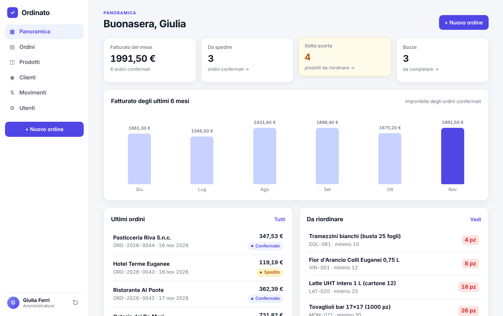
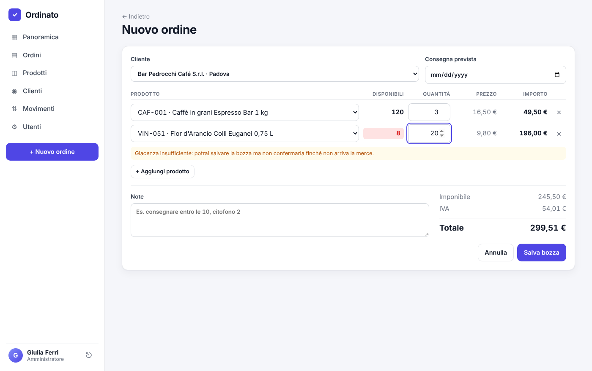
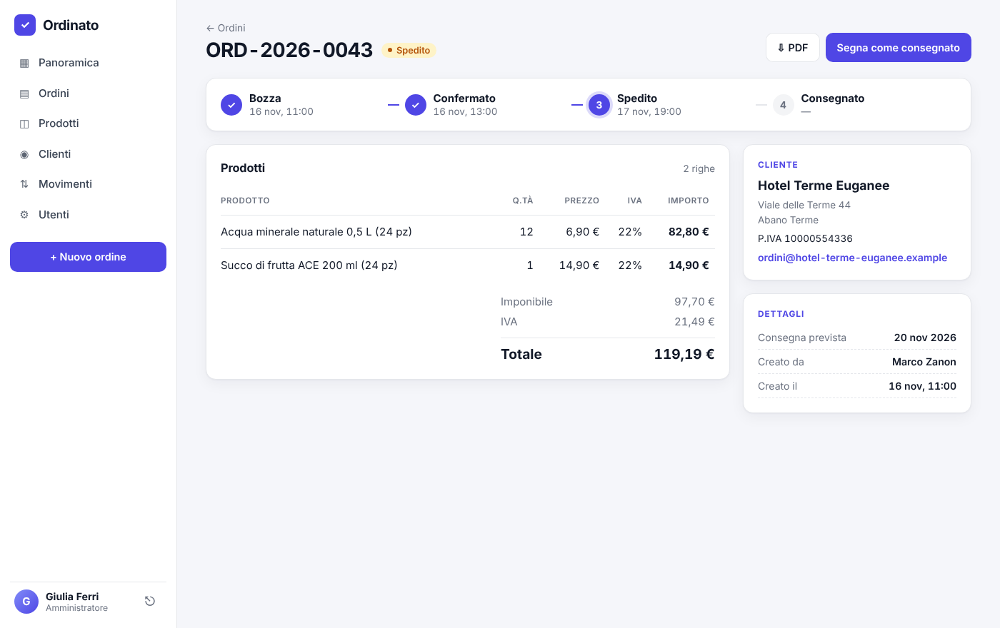
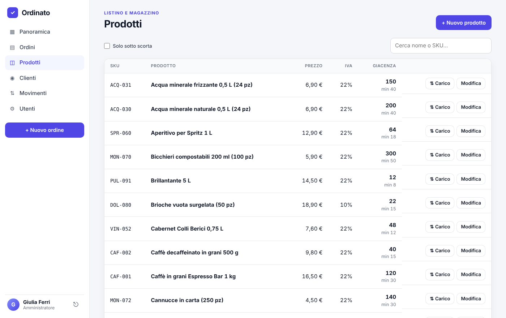
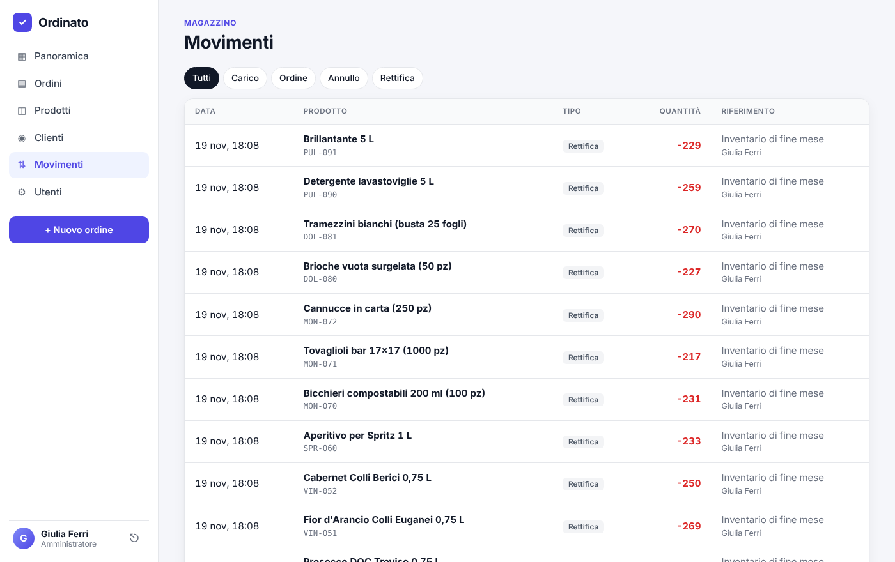

# Ordinato · Gestionale ordini e magazzino

Web app per una piccola azienda di distribuzione: **ordini, clienti, listino e magazzino** in un unico posto.
Back-end **Laravel 13** con API REST, front-end **Vue 3** (single page app). Realizzato da **Ayoub Balhouh**.



**Prova la demo:** accedi come *Amministratore* o *Operatore* con un clic dalla pagina di login
(`admin@ordinato.test` / `password`, `operatore@ordinato.test` / `password`). I dati demo si ripristinano a ogni riavvio.

## Funzionalità

**Ordini**
- Creazione con più prodotti, totali e IVA calcolati in tempo reale; avviso se la giacenza non basta
- Flusso di stato: bozza → confermato → spedito → consegnato (o annullato), con data di ogni passaggio
- **Alla conferma la merce viene scaricata dal magazzino** in una transazione con lock delle righe: se un prodotto non basta, non cambia niente
- Annullando un ordine confermato la merce torna in magazzino
- Le righe salvano prezzo e IVA del momento: se il listino cambia, gli ordini vecchi restano corretti
- **PDF dell'ordine** generato dal server (DomPDF)

**Magazzino e listino**
- Prodotti con SKU, prezzo, IVA, giacenza e scorta minima; filtro "sotto scorta"
- Carichi e rettifiche con nota; la giacenza non può andare sotto zero
- Storico di tutti i movimenti (carico, ordine, annullo, rettifica) con utente e riferimento all'ordine

**Clienti** con controllo della **partita IVA italiana** (cifra di controllo) e fatturato per cliente.

**Panoramica**: fatturato del mese, ordini da spedire, prodotti da riordinare, grafico degli ultimi 6 mesi.

**Utenti e permessi**: gli *operatori* gestiscono ordini e clienti; gli *amministratori* anche listino, magazzino e utenti. I permessi sono controllati lato server (Gate e Form Request), non solo nascosti nell'interfaccia.

| Nuovo ordine | Dettaglio ordine |
|---|---|
|  |  |

| Prodotti | Movimenti di magazzino |
|---|---|
|  |  |

## Architettura

```
Vue 3 SPA (vue-router, axios)  ──►  API REST Laravel  ──►  SQLite / MySQL
        cookie di sessione + CSRF (Sanctum)
```

- **Autenticazione**: Laravel Sanctum in modalità SPA (cookie di sessione e token CSRF), nessun token salvato nel browser
- **API**: Resource controller, API Resources per l'output, Form Request per la validazione, paginazione e filtri
- **Logica di dominio** in `app/Services/OrderService.php` e `app/Enums/OrderStatus.php` (transizioni di stato consentite)
- **Validazione** con messaggi in italiano e regola personalizzata `PartitaIva`
- **Front-end**: componenti Vue con `<script setup>`, caricamento delle pagine a richiesta (code splitting), CSS scritto a mano, responsive

## Test

15 test PHPUnit sull'API: totali e numerazione, scarico del magazzino alla conferma, giacenza insufficiente senza modifiche parziali, annullo con reso, transizioni non valide, permessi per ruolo, partita IVA, PDF, login con sessione.
GitHub Actions esegue i test e la build del front-end a ogni push.

```bash
php artisan test
```

## Avvio in locale

```bash
git clone https://github.com/ayoubbalhouh/gestionale-ordini.git
cd gestionale-ordini
composer install
npm install && npm run build
cp .env.example .env
php artisan key:generate
php artisan migrate --seed
php artisan serve
```

Apri http://127.0.0.1:8000 (imposta `APP_URL=http://127.0.0.1:8000` nel file `.env`).

## Deploy

Il repository contiene un `Dockerfile` (build di Vue con Node, dipendenze con Composer, immagine finale PHP 8.3 + Apache) e un `render.yaml` per pubblicarlo su [Render](https://render.com): *New → Blueprint* e scegli il repository.

## Struttura

- `app/Http/Controllers/Api/` – controller dell'API
- `app/Services/OrderService.php` – ordini e magazzino
- `app/Enums/OrderStatus.php` – stati e passaggi consentiti
- `app/Rules/PartitaIva.php` – validazione partita IVA
- `resources/js/` – applicazione Vue (pagine, componenti, router)
- `tests/Feature/` – test dell'API

> Progetto dimostrativo: azienda, clienti e ordini sono inventati.
